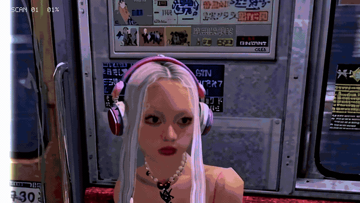
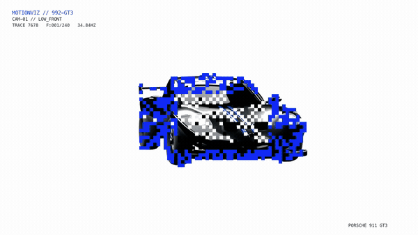

<p align="center">
  
</p>

<h1 align="center">MotionViz Playbook &amp; Agent Skills</h1>

<p align="center">
  <strong>Turn any raw clip or 3D model into studio-grade optical scans, kinetic Blender showreels, and agency-grade brand &amp; web systems — locally for $0.</strong>
</p>

<p align="center">
  <a href="https://github.com/adi0900/MotionWiki-Playbook"></a>
  <a href="https://x.com/Motion_Viz"></a>
  <a href="https://linktr.ee/motionviz"></a>
</p>

---

## Install in One Command

Works with **Claude Code**, **Codex**, **Gemini / Antigravity**, and any Agent Skills-compatible client:

```bash
npx skills add https://github.com/adi0900/MotionWiki-Playbook.git
```

---

## What You Get (Live Showcases)

### 1. `flatbed-scanner-film` — 1200 DPI Optical Flatbed CCD Slit-Scan

<p align="center">
  
</p>

Drop in **any raw video clip** and turn it into a frame-synced **14.5-second 1200 DPI optical flatbed scanner film** locally on your machine for **$0** — zero After Effects plugins, zero paid VFX packs, zero extra AI tokens.

- **Local foreground cutouts:** Native macOS **Apple Vision** (`VNGenerateForegroundInstanceMaskRequest`, `~8s` for 193 frames) with automatic `rembg` fallback on Linux/Windows.
- **Temporal RGB CCD slit-scan:** Clinical off-white flatbed lightbox glass with procedural dust/micro-fibers + pitch-black RGB X-ray darkroom void.
- **Dot-matrix technical HUD:** Custom `--brand`, `--subtitle`, and `--obj1..3` specimen labels.
- **Frame-synced procedural soundtrack:** Mechanical carriage ratchet, servo light-bar sweeps, sub-bass, glitch arpeggios, and cut impacts synthesized in NumPy.
- **Exports:** `9:16` (`1080×1920` cinema strip), `16:9` (`1920×1080`), or `both` in browser-safe H.264 + AAC.

```bash
python3 skills/flatbed-scanner-film/scripts/run_pipeline.py \
  --input /path/to/your_clip.mp4 \
  --out ./scanner_out \
  --aspect both \
  --brand "YOUR BRAND" \
  --subtitle "1200 DPI SCAN"
```

---

### 2. `blender-kinetic-showreel` — Procedural 3D Studio + Kinetic Editorial VFX

<p align="center">
  
</p>

End-to-end **Blender 4.2+/5.x + Python VFX pipeline** to build or import any 3D vehicle or product, light it in a high-contrast dark-metallic pure-white studio, animate multi-angle zero-clipping cameras (`4:5` vertical or `16:9` widescreen), and composite kinetic editorial motion graphics.

- **Zero-clipping studio cameras:** Automated orbit, low-angle hero, wheel/detail, and rear-quarter shots.
- **Kinetic editorial VFX layer:** Computer-vision tracking webs, B&W specular node graphs, Bayer-dithered halftone waves, strobing inverted-contrast typography, HUD telemetry, and seamless loop glitches.
- **Fully scripted:** Reproducible Blender Python + FFmpeg pipeline in [`skills/blender-kinetic-showreel/`](./skills/blender-kinetic-showreel/SKILL.md).

---

## Full Skills & Instruction Index

| Skill / File | What It Does | Best For |
|---|---|---|
| [`skills/flatbed-scanner-film`](./skills/flatbed-scanner-film/SKILL.md) | 1200 DPI optical flatbed CCD slit-scan + Apple Vision cutouts + procedural synth audio | Turning any raw AI or camera clip into a `$0` art-directed reel |
| [`skills/blender-kinetic-showreel`](./skills/blender-kinetic-showreel/SKILL.md) | Procedural 3D studio lighting, multi-angle cameras, and kinetic editorial VFX compositing | High-contrast 3D vehicle / product showreels in Blender 5.x |
| [`visual-identity/skills/BRANDING/Brand-MV.skill`](./visual-identity/skills/BRANDING/Brand-MV.skill) | Identity boards, symbol logic, typography direction, palette systems | Brand identity & compressed design guidelines |
| [`website-design/skills/Design-MV.md`](./website-design/skills/Design-MV.md) | Structured, anti-slop landing pages & product-site architecture | High-craft product & marketing websites |

---

## Repository Layout

```text
MotionWiki-Playbook/
├── skills/
│   ├── flatbed-scanner-film/        # 1200 DPI optical scanner skill + Swift/Python scripts
│   └── blender-kinetic-showreel/    # Blender 5.x 3D studio + kinetic editorial VFX scripts
├── visual-identity/skills/BRANDING/ # Brand identity skill
├── website-design/skills/           # Web design direction skill
├── assets/                          # Animated showcase GIFs
└── instructions.md                  # Setup patterns & usage notes
```

---

## Links & Support

- **Follow updates & new drops:** [@Motion_Viz on X](https://x.com/Motion_Viz)
- **All links:** [linktr.ee/motionviz](https://linktr.ee/motionviz)
- **Support MotionViz:** [Whop](https://whop.com/checkout/plan_wmAQHOcSQVt0G)
